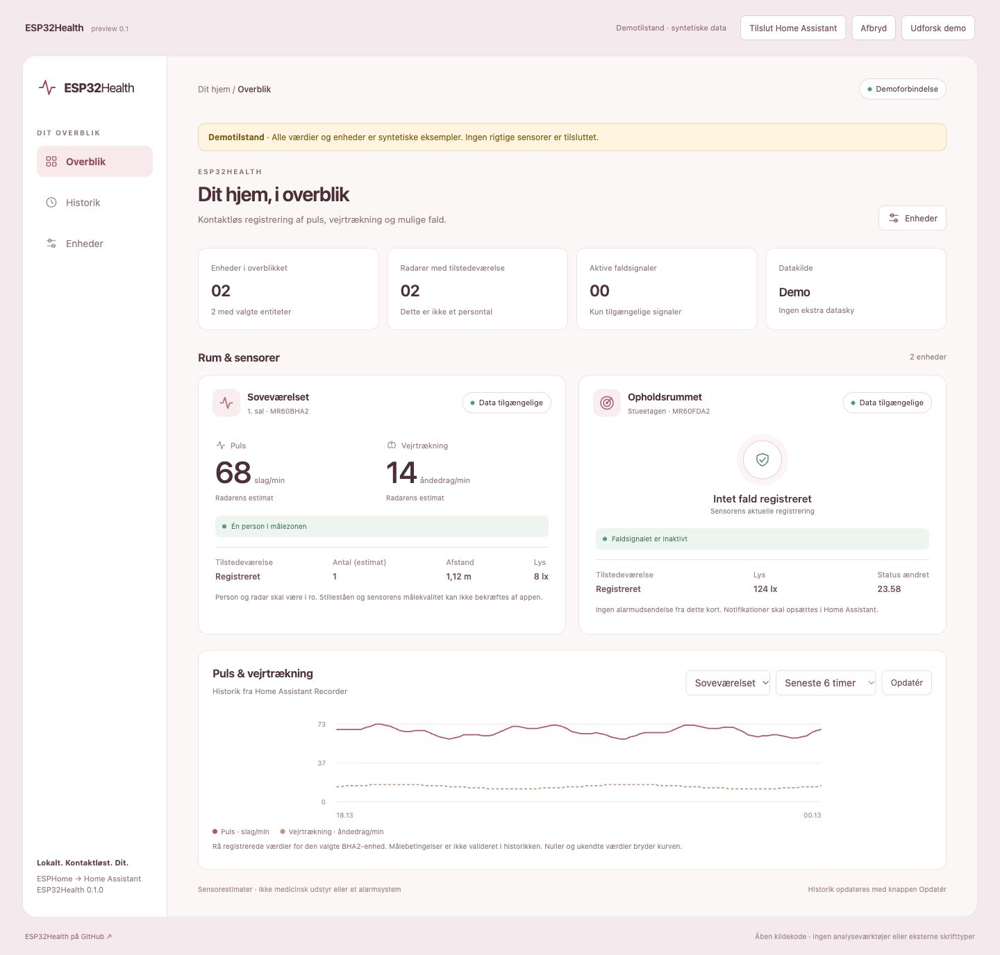

# ESPHealth til Home Assistant

**ESPHealth installeres som en app under Indstillinger → Apps i Home Assistant**, på samme måde som ESPScripts. Appen åbnes med **Åbn web-UI** og kan vises i sidepanelet.

[](https://my.home-assistant.io/redirect/supervisor_add_addon_repository/?repository_url=https%3A%2F%2Fgithub.com%2FJRJenZens%2FESPHealth)

[**Tilføj repository i Home Assistant**](https://my.home-assistant.io/redirect/supervisor_add_addon_repository/?repository_url=https%3A%2F%2Fgithub.com%2FJRJenZens%2FESPHealth) · [Dansk installationsvejledning](esp32health/DOCS.md)



## Installation

1. Åbn linket ovenfor og tilføj repository. Alternativt: **Indstillinger → Apps → App-butik → ⋮ → Repositories**, og tilføj `https://github.com/JRJenZens/ESPHealth`.
2. Find **ESPHealth**, og vælg **Installér**. Første installation bygger appen og kan tage nogle minutter.
3. Vælg **Start** og derefter **Åbn web-UI**. Aktivér eventuelt **Vis i sidepanel**.
4. Gå til **Enheder** i ESPHealth, og vælg **Find Seeed-enheder**, eller vælg **Vælg ESPHome-enhed** for at forbinde en fysisk enhed manuelt.
5. Kontrollér entiteterne. Opsætningen gemmes automatisk i appen og bruges på tværs af dine enheder.

Kræver Home Assistant OS eller en Supervisor-installation med Apps. Sensorerne skal allerede være tilføjet til Home Assistant via ESPHome. Der skal ikke indtastes URL, adgangstoken eller opsættes et dashboardkort. Den aktuelle app retter sig mod HA-administratorer.

## Sensorer og funktioner

- **MR60BHA2:** radar-estimeret puls og vejrtrækning, tilstedeværelse, afstand, estimeret antal personer og eventuelt lysniveau.
- **MR60FDA2:** tilstedeværelse, aktuelt faldsignal og eventuelt lysniveau.
- Flere radarer med separate navne, områder og entitetskoblinger.
- Manuel liste over ESPHome-enheder og radarmodelvalg. Sensorvalg afgrænses til den valgte fysiske enhed; generiske ESP32-modelnavne og danske sensornavne understøttes.
- Liveopdateringer, automatisk genforbindelse og rådata med forklaring, når målinger mangler.
- Monitor med store tal og frekvensbaseret rytmeanimation, tydeligt mærket som illustration og ikke EKG.
- Valgfrie grænser for høj/lav puls og vejrtrækning, manglende signal og muligt fald. Beskeder til Home Assistant eller en valgt Companion-app, med valg mellem almindelig og kritisk besked på iPhone/iPad samt en testknap.
- Recorder-historik for 1, 6, 12 eller 24 timer samt CSV-eksport.
- Bordeaux og rosa design, som tilpasser sig computer, iPhone og iPad.

Appen bruger Home Assistants interne API gennem Supervisor. Login og adgang til web-UI håndteres gennem Ingress. Opsætningen ligger i appens private `/data/config.json` og følger med en sikkerhedskopi af appen. Målehistorik bliver i Home Assistant Recorder; Appen gemmer en lokal log over de seneste 50 alarmhændelser i `/data/alerts.json`. [Teknisk dokumentation om Ingress](https://contributors.home-assistant.io/apps/guides/ingress/).

## Status-LED på radaren

Installér [ESPHome-fragmentet til status-LED](examples/esphealth-status-led.yaml) på hver radar, og vælg **Enheder → Status-LED** i ESPHealth. Vælg **ESPHealth LED status** fra samme fysiske radar, markér **Brug radarens LED til ESPHealth-status**, og tryk **Gem LED-indstillinger**. Enheds- og sensorkoblinger gemmes fortsat automatisk; LED-valget gemmes med sin egen knap.

| Visning | Betydning |
| --- | --- |
| Svagt konstant grønt | Radaren registrerer en person |
| Gult blink | En konfigureret almindelig alarm er aktiv |
| Rødt blink | En konfigureret kritisk alarm er aktiv |
| Blåt blink | Ingen statusopdatering via HA/ESPHealth i 45 sekunder |
| Slukket | Ingen person, eller LED-styring slået fra |

Grønt betyder tilstedeværelse, ikke at sundhedsværdier er normale. Rød har prioritet over gul. Afventende alarmtimere giver ikke alarmfarver. Blinket kører lokalt med cirka én periode pr. sekund; appen sender status hvert 15. sekund, også når sensorværdierne ikke ændrer sig. Hvis HA eller appen stopper, viser den lokale watchdog blåt efter timeout. Aktiveringen gemmes lokalt; en gammel alarmfarve genoptages ikke som en ny alarm ved genstart.

Appen styrer kun en kompatibel LED-vælger på samme fysiske ESPHome-enhed som sensorernes registrering. Den har ingen generisk styring af lys, radar-kalibrering eller vilkårlige select-entiteter. Fragmentet kræver eksisterende IDs `rgb_led` og `radar_presence`; følg kommentarerne i filen og flet lister ind i den eksisterende YAML. Sensor- og netværksopsætning skal bevares. Byg og validér i ESPHome før installation.

## Valgfrie alarmregler

Alarmstatus og seneste hændelser står nederst, så indstillingerne er direkte tilgængelige øverst.

Åbn **Alarmer**, vælg modtager og dine egne grænser, markér **Slå alarmer til**, og tryk **Gem alarmindstillinger** for hver radar. Alt er slået fra ved installation; tomme grænser betyder ingen regel. Regler kører i appen, også når web-UI er lukket, og kræver en kørende app og Home Assistant.

MR60BHA2 har to niveauer for hver af de fire betingelser: puls under/over og vejrtrækning under/over. **Alarm** sender en almindelig besked; **Kritisk alarm** sender en kritisk besked til en Companion-modtager. Hver grænse har sin egen **Sammenhængende sekunder** (1–3600). Den kritiske lavgrænse skal være lavere end eller lig alarmens; den kritiske højgrænse højere end eller lig alarmens. Samme værdi kan bruges med forskellige varigheder.

En timer starter, når en brugbar måling overskrider den konkrete grænse. Den nulstilles ved en normal eller utilgængelig måling; en kort overskridelse tæller ikke med i næste periode. Kritisk eskalering har sin egen timer og beskedbegrænsning og blokeres ikke af en tidligere almindelig alarm. Hvis begge niveauer udløses samtidig, sendes kun den kritiske besked. Mens kritisk niveau er aktivt, udelades en samtidig almindelig besked for samme betingelse. Ved nedtrapning kan en stadig overskredet almindelig grænse igen blive aktiv.

Signaltab og FDA2-faldsignal har fortsat egen fælles varighed og et valg af almindelig/kritisk beskedtype. Signaltabsreglen omfatter også nulmålinger, ingen person, forkert målezone og afbrudt forbindelse. Manglende signal dokumenterer ikke vejrtrækningsstop.

Kritisk lyd kræver tilladelse til kritiske advarsler i iPhones/iPads notifikationsindstillinger og kan da afspille lyd trods lydløs tilstand og Fokus. Profilen er til iOS; denne udgave etablerer ikke Android-alarmkanaler. Se [Companion-dokumentationen](https://companion.home-assistant.io/docs/notifications/critical-notifications/).

De to testknapper afprøver almindelig eller kritisk afsendelse uden at gemme eller aktivere alarmregler. De bruger samme afsendelse som alarmerne og gemmer resultatet i loggen. Højst én test hvert 10. sekund. Home Assistants accept er ikke bevis for modtagelse; kontrollér telefonen.

Der sendes én besked pr. hændelse og højst én pr. betingelse og niveau hvert femte minut. Genstart, ændret opsætning eller afbrudt måling starter en ny afventende periode; allerede udløste hændelser deduplikeres efter genstart. Afsendelsesfejl eller uafklaret levering gentages ikke automatisk og vises i loggen.

Ved opdatering fra 0.3 bevares grænser, aktivering, modtager og den hidtidige varighed. Tidligere almindelige grænser flyttes til Alarm; tidligere kritiske grænser til Kritisk alarm. Der indsættes ingen nye kritiske grænser. Gennemgå opsætningen før næste aktivering. Ved tilbagerulning skal en fuld backup med den tidligere opsætning gendannes, da 0.3 ikke kender de nye felter.

Appen er ikke en medicinsk alarm eller et nødopkaldssystem. Vælg grænser efter dit konkrete behov; der er ingen anbefalede medicinske standardgrænser.

## Overgang fra version 0.1

Fra **0.2.0** distribueres ESPHealth kun som Home Assistant-app. Hvis du har installeret dashboardkortet gennem Marketplace/HACS, kan du fjerne det gamle kort og dets ressource og afinstallere den gamle pakke. Tilføj derefter dette repository under **Apps**. Sensorerne i ESPHome/Home Assistant skal bevares.

Den nye app har sin egen centrale opsætning. Tidligere browser- eller kortopsætninger flyttes ikke automatisk; vælg enhederne igen i appen. Historik, der ligger i Recorder, bliver bevaret. De tidligere 0.1-udgivelser findes fortsat som versionshistorik på GitHub.

## Målingernes begrænsninger

Aktuelle BHA2-vitalestimater vises kun ved registreret tilstedeværelse, ét estimeret mål, afstand på 0,5–1,5 m og nylige positive tal. Afstand omregnes ud fra entitetens måleenhed, herunder ESPHomes standard cm. Nul, ukendte værdier, tvetydige målebetingelser og afbrudt forbindelse vises ikke som normale vitalværdier.

`last_reported` bruges, hvis det er tilgængeligt, ellers `last_updated`. Stabilt gentagne tal kan derfor blive skjult konservativt. `force_update` på de numeriske ESPHome-sensorer kan hjælpe med opdateringstider, men kan øge Recorder-skrivninger og beviser ikke, at radarens estimat er nyt. Se [ESPHome-fragmenter](examples/esphome-entities.yaml).

Sensorerne kan fastholde gamle estimater, og appen kan ikke bekræfte stilleståen eller signalets kvalitet. Historik og CSV viser rå Recorder-værdier. ESPHealth er ikke medicinsk udstyr eller et certificeret alarmsystem og kan sende vejledende beskeder efter dine egne regler. Manglende signal dokumenterer ikke vejrtrækningsstop. [Enhedsnoter og kilder](docs/devices.md).

## Udvikling og afprøvning

Backend: Python 3.13 og aiohttp. Frontend: almindelige JavaScript-moduler uden byggetrin. Runtime-pakken ligger under `esp32health/`; root `repository.yaml` gør den synlig i app-butikken.

```sh
python3 -m venv .venv
.venv/bin/pip install -r esp32health/requirements.txt
.venv/bin/python -m unittest discover -s tests -p 'test_*.py'
npm test
```

`npm test` kræver Node.js 20+. `tests/preview.py` er en udviklingsfixture med syntetiske data under en Ingress-lignende URL. Den tilgår ikke en rigtig HA-installation og er ikke med i containeren.

Versionen er fortsat under udvikling. Se [validering og kendte grænser](docs/validation.md). [Bidrag](CONTRIBUTING.md) · [Sikkerhed](SECURITY.md) · [MIT-licens](LICENSE).
